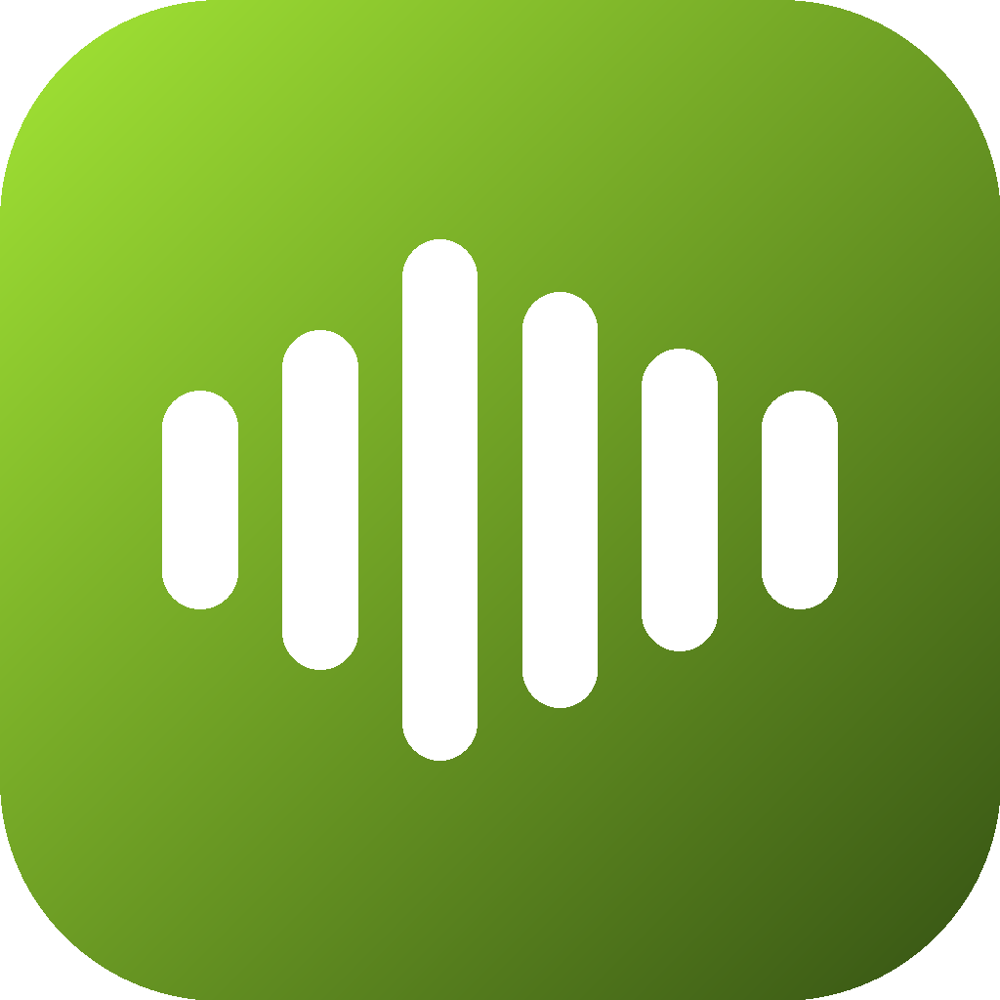

<div align="center">

<br/>



# Sonariq for iOS

### Your music, in glass.

*The native iPhone music player — Liquid Glass design, true word-by-word synced lyrics, and a real 7-band equalizer.*

<br/>

[](https://github.com/sonariq-source/Sonariq-iOS/releases)
[](https://github.com/sonariq-source/Sonariq-iOS/blob/main/LICENSE)
[](https://github.com/sonariq-source/Sonariq-iOS/actions)
[](https://github.com/sonariq-source/Sonariq-iOS/releases)
[](https://ko-fi.com/sonariqstudio)

<br/>

[**Download**](#-download) · [**Features**](#-features) · [**Install**](#-install-sideload) · [**Building**](#-building-from-source) · [**Roadmap**](#-roadmap) · [**License**](#-license)

</div>

> [!NOTE]
> **Beta.** Sonariq for iOS is in active development — expect rough edges. Requires iOS 17 or newer; the Liquid Glass interface needs iOS 26.

---

## 📲 Download

Get **Sonariq-unsigned.ipa** from the [latest release](https://github.com/sonariq-source/Sonariq-iOS/releases). Every push to `main` also builds a fresh IPA as a CI artifact.

---

## ✨ Features

### 🎵 Playback
- **Your library, at home** — Home tab with stats, an albums shelf, and your playlists, all read live from the device.
- **Album & playlist views** — open any album or playlist and play it straight through.
- **Queue** — its own tab: jump to any song, reorder, remove, or clear, with a live count badge.
- **Background audio** with lock-screen and Control Center controls.
- **Live Activity** — now playing on the lock screen and the Dynamic Island, with artwork and progress.

### 📝 Synced lyrics
- **True word-by-word highlighting** — words light up exactly when sung, and only when the provider genuinely timed them.
- **Clean line sync** everywhere else — no estimated or faked timings, ever.
- **Two providers raced in parallel** with smart recording matching, a 12-second timeout, and a 30-day on-device cache.
- **Instrumental-break markers** so long silences read as silence.

### 🎚 Sound
- **Real 7-band equalizer** — the EQ sits inside the audio engine, so the sliders shape the sound you actually hear.
- **Presets** — Flat, Bass Boost, Treble Boost, Vocal, Dance, Rock, Jazz.
- **Sample-accurate progress** and seeking, headphone-unplug pause, and call-interruption handling.

### 🫧 Design
- **Liquid Glass interface** on iOS 26 and newer — mini player, controls, and cards rendered in true glass.
- **Frosted-material fallback** on older iOS, same layout.
- **Prism theme** — matte midnight/plum with coral, orchid, and cyan accents, dark by design.

---

## 📦 Install (sideload)

The release IPA is unsigned, so it needs your own signature:

1. Download **Sonariq-unsigned.ipa** from the [latest release](https://github.com/sonariq-source/Sonariq-iOS/releases).
2. Sideload it with SideStore or Feather and sign it with your Apple ID when asked.
3. Open Sonariq, allow access to your music library, and play.

> A free Apple ID signature expires every 7 days — just re-sign to keep it working.

---

## 🔨 Building from source

No Mac required for day-to-day work — GitHub Actions builds and packages the IPA on every push.

To build locally you need a Mac with Xcode 16 or newer:

```bash
git clone https://github.com/sonariq-source/Sonariq-iOS.git
cd Sonariq-iOS
cp Sonariq/Secrets.xcconfig.example Sonariq/Secrets.xcconfig  # then fill in keys
open Sonariq.xcodeproj
```

Run the **Sonariq** scheme on a simulator or device.

### Project layout

| Path | What lives there |
|---|---|
| `Sonariq/` | The app — SwiftUI views, the `AVAudioEngine` player, lyrics engine |
| `Sonariq/Lyrics/` | Lyrics models, LRC + TTML parsers, providers, race engine, cache |
| `Sonariq/Player/` | Playback engine, Now Playing, mini player |
| `SonariqWidget/` | Live Activity widget extension |
| `Sonariq/Secrets.xcconfig.example` | Shape of the secrets file (the real one is gitignored) |

### Secrets

API keys never live in the repo. Copy `Sonariq/Secrets.xcconfig.example` to `Sonariq/Secrets.xcconfig` (gitignored) and fill it in; CI injects the same values from repository secrets. A fresh checkout builds and runs with key-gated features simply disabled.

---

## 🗺 Roadmap

- Streaming sources
- Listen Together
- CarPlay
- Home-screen widgets

---

<div align="center">

## ☕ Support Sonariq

Sonariq is free and made by an independent developer. If it soundtracks your days, consider [buying a coffee](https://ko-fi.com/sonariqstudio) — every bit goes back into new features, design polish, and keeping the servers running.

<a href="https://ko-fi.com/sonariqstudio" target="_blank" rel="noopener noreferrer"></a>

</div>

---

## 📄 License

GPL-3.0 — see [LICENSE](LICENSE). Open source, like the rest of the Sonariq family.

---

<div align="center">

by Sonariq studio

</div>
